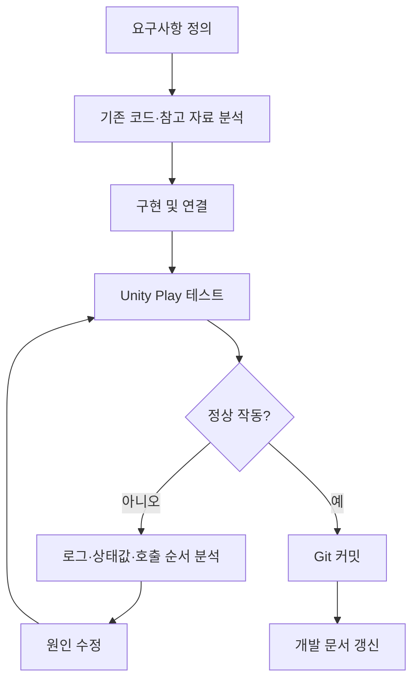
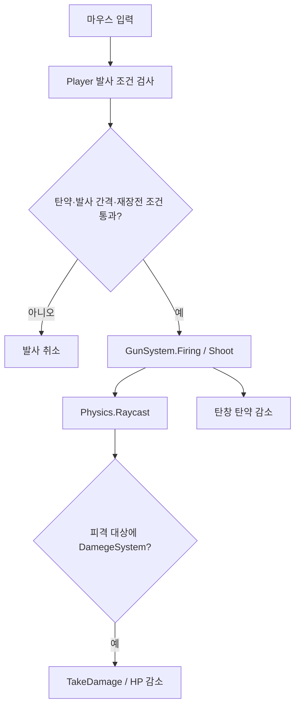
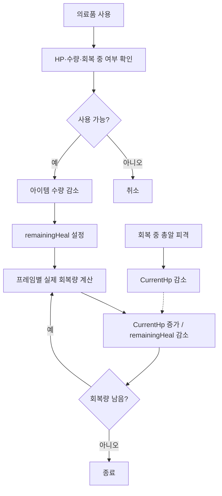

# Development Flow — 개발 절차와 실행 흐름

`flowchart TD`는 Mermaid에서 위→아래 방향의 흐름도 선언이다. 아래 **개발 절차**와 **게임 실행 흐름**은 서로 다르다.

## 개발·검증 절차

이 그림은 반복 작업 절차의 개념도다. 실제 변경의 날짜순 기록은 Git 커밋 이력을 근거로 별도 작성해야 한다.

## 확인된 개선 과정
1. **Enemy:** switch FSM → `IEnemyState` 상태 클래스 분리 → 중복 Enemy 초기화 호출 제거 확인.
2. **Shooting:** 테스트용 탄약값 제거 → 탄창·인벤토리 재장전 연동 → 탄약이 없을 때 재장전 애니메이션만 실행되던 문제 수정.
3. **Inventory/HP:** 의료품 사용 연결 → `CurrentHp` 미증가 수정 → 고정 목표 HP가 피격을 상쇄하던 문제 수정 → `remainingHeal` 방식으로 검증.

## 런타임: 사격

## 런타임: 회복 중 피격

## Unity 테스트 확인
HP 30 + 회복 70 → 100; 회복 중 피해 10 → 90; 의료품 마지막 1개 사용 정상. 나머지 경계 상황은 시스템별 개발 문서 참조.
