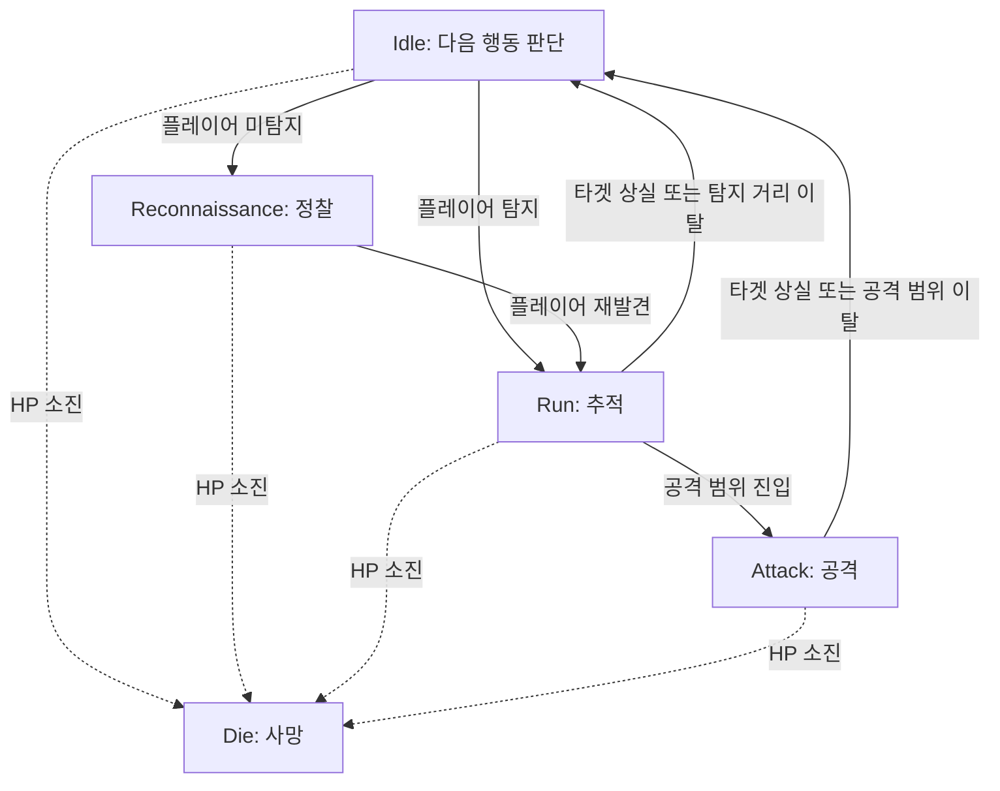

# Unity FPS 적 AI FSM 개발 및 구조 개선

> 프로젝트: [youngchan-kim/fps_project](https://github.com/youngchan-kim/fps_project)  
> 개발 환경: Unity / C# / NavMeshAgent  
> 최종 점검일: 2026-10-18  
> 코드 기준: GitHub `main` 브랜치의 `EnemyFSM.cs`, `Enemy.cs`, `GameMgr.cs` 재확인  
> 검증 범위: **코드 정적 검토 + 작성자가 Unity에서 직접 확인한 핵심 동작**. 본 문서 작성자가 Unity 실행을 독립 재현한 것은 아님.

## 1. 개발 배경 및 목적

적 캐릭터가 플레이어를 탐지하고 추적하다 공격 범위에 들어오면 사격하며, 플레이어를 놓치면 마지막으로 확인한 위치를 중심으로 정찰하도록 행동을 설계했다.

초기에는 `Enemy.cs`의 `switch` 기반 FSM으로 상태 전환을 관리했다. 이후 상태 관리 책임을 분리하기 위해 `EnemyFSM.cs`와 `IEnemyState` 인터페이스를 도입하여 **클래스 기반 State Pattern FSM으로 리팩터링**했다. 기존에도 FSM이 존재했으므로 'FSM을 새로 도입'한 것이 아니라 '기존 FSM 구조를 개선'한 사례다.

## 2. 구현 구조

- **`EnemyFSM`**: 현재 `IEnemyState` 보관; `ChangeState()`에서 기존 상태 `Exit()` 후 새 상태 `Enter()` 호출; HP 기반 사망 상태 전환.
- **`IEnemyState`**: `Enter()`, `Update()`, `Exit()` 인터페이스.
- **`IdleState`**: 현재 플레이어 탐지 결과를 기준으로 `RunState` 또는 `ReconnaissanceState` 선택. 장시간 대기하는 상태가 아니라 **다음 행동을 판단하는 분기 상태**.
- **`ReconnaissanceState`**: 탐지 중이면 `RunState`로 전환; 아니면 `Enemy.UpdateReconnaissance()`로 이동·탐색.
- **`RunState`**: 타겟을 추적하고 공격 거리 진입 여부를 판단; 타겟 상실 또는 탐지 거리 이탈 시 `IdleState`.
- **`AttackState`**: 사격 처리; 타겟 상실 또는 공격 거리 이탈 시 **직접 Run이 아닌 Idle**로 전환.
- **`DieState`**: 사망 행동 호출.
- **`Enemy`**: 실제 NavMesh 이동, 공격, 애니메이션 및 FSM 초기화.
- **`TargetCheck`**: 범위·시야각·Raycast 기반 타겟 탐지, 타겟 상실 시 마지막 위치 `Spot` 기록.

### 상태 전환도



`Die` 전환은 `EnemyFSM.Update()`에서 공통으로 검사한다. 상태를 변경해도 새 상태의 `Update()`는 같은 호출에서 즉시 실행되지 않는다.

## 3. 주요 설계 의도와 결정

### 3.1 공격 이탈 시 `Attack → Idle` 유지

공격 범위를 벗어난 플레이어가 **계속 보이는 상황(도주)**과 **시야에서 사라진 상황(엄폐)**을 같은 방식으로 추적하지 않도록 `Idle`에서 탐지 결과를 재판단한다.

- 플레이어가 다시 탐지되면 `Idle → Run`.
- 플레이어가 탐지되지 않으면 `Idle → Reconnaissance`.

따라서 `Attack → Run` 직접 전환이 없는 것은 누락이 아닌 **의도적인 설계**다.

### 3.2 마지막 위치 탐색

`TargetCheck.TargetLost()`가 마지막 확인 위치를 `Spot`에 저장하고, `Enemy.UpdateReconnaissance()`는 `Spot`을 NavMeshAgent 목적지로 사용한다. 이동 중에도 매 프레임 탐지를 수행한다. `distance < in_spot_len`이면 새 무작위 탐색 지점을 지정한다.

별도의 '마지막 위치 도착 완료' 상태를 두지 않는 것은 **이동하면서 계속 탐색하는 방식**을 선택했기 때문이다. 도착 판정을 독립 FSM 상태로 추가하는 것은 현재 요구사항이 아니다.

### 3.3 타겟 선정 범위

현재 게임은 **단일 플레이어를 적 AI의 대상으로 설정**한다. `TargetCheck`는 복수 후보 간 거리 기반 우선순위를 구현하지 않았으며, 현재 요구사항에서는 다중 타겟 확장을 계획하지 않는다. 이 전제를 명시하고 범용 다중 타겟 AI라고 소개하지 않는다.

### 3.4 공격 상태와 이동 책임

`Enemy.UpdateAttack()`은 공격 중 `agent.speed = 0`으로 설정하고, 추적은 `Enemy.UpdateRun()`에서 `Run_speed`로 재설정한다. 공격 상태가 추적 이동까지 담당할 필요는 없으며, 이동 속도 복원은 Run의 책임이다.

## 4. 검증 결과

| 항목 | 확인 결과 | 근거 |
|---|---|---|
| 5개 상태 및 `IEnemyState` 구현 | 코드 확인 | `EnemyFSM.cs` |
| 플레이어 탐지 및 추적 | **Unity 동작 확인** | 작성자 직접 확인 |
| 공격 및 사격 | **Unity 동작 확인** | 작성자 직접 확인 |
| 타겟 상실 후 정찰 복귀 | **Unity 동작 확인** | 작성자 직접 확인 |
| 시스템 내부 HP 감소 및 사망 | **Unity 동작 확인** | 작성자 직접 확인 |
| 적 HP 감소 UI 표시 | 미구현 | 작성자 설명 |
| 사망 애니메이션·3초 후 비활성화 | 코드 경로 확인, 개별 실행 검증 미확인 | `Enemy.UpdateDie()`, 코루틴 |
| 오브젝트 풀링 | 미구현, 향후 계획 | 작성자 설명 |

**주의:** UI에 HP가 표시되지 않는다는 사실과 내부 HP 감소·사망이 작동한다는 사실은 구분한다. Unity 플레이 모드 실행을 문서 작성자가 독립적으로 테스트한 것은 아니다.

## 5. 중복 초기화 문제 및 GitHub 재확인

### 이전 문제

기존에는 `Enemy.Start()`와 `GameMgr.StartGame()` 모두에서 `Enemy.Initialize()`를 호출했다. `Initialize()`는 HP를 재설정하고 FSM을 다시 생성하므로 의도치 않은 중복 실행 가능성이 있었다.

### 반영 확인: 해결

2026-10-18 GitHub `main` 재확인 결과:

**`GameMgr.cs`**

```csharp
void StartGame()
{
    player.GetComponent<Player>().Initialize();
    // Enemy는 자신의 Start()에서 초기화
    //enumy.GetComponent<Enemy>().Initialize();
    GUI_Mgr.GetComponent<GUI_Mgr>().Initialize();
}
```

**`Enemy.cs`**

```csharp
void Start()
{
    ATKpoint = GetComponent<Findattackpoint>();
    damegeSystem = GetComponent<DamegeSystem>();
    //enemy 본인을 초기화
    Initialize();
}
```

따라서 **GameMgr와 Enemy가 중복으로 Enemy를 초기화하던 호출은 제거된 것으로 확인**했다. 다만 이 변경 이후의 Unity 실행 재검증 여부는 별도로 확인되지 않았다.

향후 오브젝트 풀링에서 적을 재사용할 계획이 있으므로 `initialized` 플래그로 재초기화를 영구 차단하지 않는다. 풀링 도입 시 재사용 초기화 시점을 별도로 설계한다.

> **별도 개선 사항:** `GameMgr.Instance` getter와 `GameMgr.Start()`가 모두 게임 초기화를 실행할 수 있는 구조는 남아 있다. 이는 `게임 매니저 및 UI 상태 관리 개선` 키워드에서 다룬다. 현재 `GameMgr.StartGame()`의 Enemy 초기화 호출은 주석 처리되어 있으므로, 이 문제를 Enemy FSM 자체의 미해결 중복 초기화로 표현하지 않는다.

## 6. 기존 방식과 개선 방식 비교

| 항목 | 이전 switch 기반 FSM | 클래스 기반 FSM |
|---|---|---|
| 상태 보관 | `Enemy` 내부 enum 상태 | `EnemyFSM.currentState` |
| 상태 실행 | `Enemy.Update()`의 switch | 현재 상태 객체의 `Update()` |
| 상태 전환 | enum 값 직접 변경 | `ChangeState(new ...State(enemy))` |
| 진입·종료 처리 | 공통 계약 없음 | `Enter()` / `Exit()` |
| 행동 구현 | `Enemy` 메서드 | 여전히 `Enemy` 메서드, 상태 객체에서 호출 |
| 개선 의미 | 한 클래스에 상태 관리 집중 | 상태별 전환 조건 분리, 구조 파악 및 확장 용이 |

**정확한 표현:** 상태 관리와 전환 조건을 분리했지만 실제 이동·공격 구현까지 완전히 별도 클래스로 옮긴 것은 아니다.

## 7. 직접 개발 범위와 향후 과제

### 직접 설계·개선한 부분

- 플레이어 탐지 → 추적 → 공격 → 타겟 상실 시 정찰 복귀라는 행동 흐름 설계.
- 공격 거리 이탈 후 Idle을 거쳐 현재 탐지 결과에 따라 추적 또는 정찰을 선택하는 분기 설계.
- 기존 switch 기반 FSM을 인터페이스·상태 클래스를 이용한 FSM으로 리팩터링.
- 적 AI의 탐지·이동·공격·HP/사망 시스템 연동.

### 향후 과제 및 현재 범위 밖

- 오브젝트 풀링 적용과 재사용 시 초기화 설계.
- 적 HP UI 표시.
- `GameMgr` 자체의 중복 초기화 및 UI 상태 관리 개선(별도 주제).
- 실행 화면·상태 전환 로그·코드 비교 스크린샷 확보(포트폴리오 자료).

## 8. 포트폴리오 요약 문안

> Unity FPS 프로젝트에서 적 AI의 탐지·추적·공격·정찰 행동을 구현하고, 기존 switch 기반 FSM을 `IEnemyState` 인터페이스와 개별 상태 클래스를 활용한 State Pattern 구조로 리팩터링했습니다. `Idle`을 다음 행동 판단 상태로 두어 공격 범위 이탈 시 플레이어의 탐지 여부에 따라 추적 또는 정찰을 선택하도록 설계했습니다. 타겟 상실 시 마지막 확인 위치를 이동 목표로 사용하고 이동 중에도 탐지를 지속하도록 했습니다. Unity에서 탐지·추적·공격·정찰 복귀·HP 감소 및 사망의 핵심 동작을 확인했습니다.

## 9. 소스 링크

- [GitHub 프로젝트](https://github.com/youngchan-kim/fps_project)
- [EnemyFSM.cs](https://github.com/youngchan-kim/fps_project/blob/main/Assets/Resources/Script/Enemy/EnemyFSM.cs)
- [Enemy.cs](https://github.com/youngchan-kim/fps_project/blob/main/Assets/Resources/Script/Enemy/Enemy.cs)
- [GameMgr.cs](https://github.com/youngchan-kim/fps_project/blob/main/Assets/Resources/Script/GameSystem/GameMgr.cs)
- [TargetCheck.cs](https://github.com/youngchan-kim/fps_project/blob/main/Assets/Resources/Script/Enemy/TargetCheck.cs)
