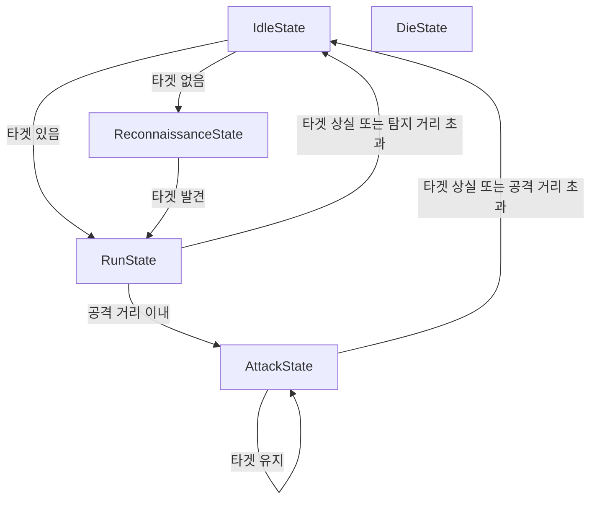

# Unity FPS 적 AI FSM 개발 및 구조 개선

> 프로젝트: Unity FPS (`youngchan-kim/fps_project`)  
> 개발 환경: Unity / C#  
> 문서 기준: GitHub `main` 커밋 `99da042066b1072a57bf75ca3fdeeebf45519bee` (2026-10-18 KST 기준)  
> 비교 버전: 이전 커밋 `57576092343ecdc7cad9cccd88f9be553179dc64`  
> 검증 구분: **소스코드 정적 검토 완료** / **Unity에서 FSM 적용·기본 동작은 작성자 확인** / **세부 시나리오 실행 검증 미완료**

## 1. 개발 배경과 직접 설계한 행동

적 캐릭터가 플레이어를 탐지하고, 가까워지면 공격하며, 대상을 놓치면 마지막으로 확인한 위치를 중심으로 탐색하도록 행동을 구상했다. 이때 범위·시야각·장애물 여부를 고려해 대상을 감지하도록 설계했다.

작성자 설명에 따르면 `IdleState`는 기본 대기·경로 판단, `ChaseState`는 탐지·추적·대상 상실 후 탐색, `AttackState`는 일정 거리에서 공격 및 거리 이탈 시 추적 복귀를 의도했다. 실제 코드에서는 이를 `IdleState`, `ReconnaissanceState`, `RunState`, `AttackState`로 구분했다. `DieState`도 있으나 추가 검증이 필요하며 `DamagedState`는 현재 소스에서 확인되지 않는다.

총기 공격임에도 사거리를 조정했던 이유는 플레이어 타겟팅과 추적 동작을 관찰하기 위한 **개발 중 테스트 설정**이다. 최종 전투 밸런스라고 주장하지 않는다.

## 2. 1차 구현 — switch 기반 FSM

이전 커밋의 `Enemy.cs`에는 `enum State { Idle, Run, Attack, Reconnaissance, Escape, Die }`가 정의돼 있었고, `Update()` 내부에서 `switch ((int)state)`로 `UpdateIdle()`, `UpdateRun()`, `UpdateAttack()` 등의 함수를 호출했다. 상태별 동작은 함수로 분리했지만 상태 전환과 상태 관리가 `Enemy.cs`에 모여 있었다.

이 방식도 FSM이다. 개선 목적은 'FSM을 처음 도입했다'가 아니라 **기존 FSM을 상태 클래스로 분리했다**는 것이다.

## 3. 2차 구현 — 클래스 기반 FSM으로 리팩터링

최신 커밋에 `EnemyFSM.cs`가 추가됐다.

- `EnemyFSM`: 현재 상태(`IEnemyState`) 보관, `ChangeState()`에서 기존 상태 `Exit()` 후 새 상태 `Enter()` 호출
- `IEnemyState`: `Enter()`, `Update()`, `Exit()` 계약
- `IdleState`: 타겟이 있으면 `RunState`, 없으면 탐색 준비 후 `ReconnaissanceState`
- `ReconnaissanceState`: 타겟 탐지 시 `RunState`, 그렇지 않으면 `Enemy.UpdateReconnaissance()`
- `RunState`: 이동과 공격 거리 진입 판단; 대상이 사라지면 `IdleState`, 가까우면 `AttackState`
- `AttackState`: `Enemy.UpdateAttack()` 실행; 타겟 소실 또는 사거리 이탈 시 `IdleState`
- `DieState`: `Enemy.UpdateDie()` 호출
- `Enemy`: 실제 이동·조준·공격·애니메이션 처리, 매 프레임 `UpdateTarget()`과 `FSM.Update()` 호출
- `TargetCheck`: `Physics.OverlapSphere`, 각도, `Physics.Raycast`로 탐지 처리 및 목표 상실 시 `Spot` 기록

### 현재 소스 기준 주요 상태 흐름

> 사망 판정은 `EnemyFSM.Update()`에서 별도로 확인해 `DieState`로 전환한다. 각 전환은 새 상태의 다음 `Update()`를 같은 프레임에 즉시 실행하지 않는다.

## 4. 요청한 5개 검토 항목

| 항목 | 판정 | 근거와 남은 작업 |
|---|---|---|
| ① 상태 전환 검증 | **구조 확인 / 실행 검증 일부** | `EnemyFSM.ChangeState()`와 상태 클래스 연결 확인. 실제 전이마다 Unity 로그 검증 필요. |
| ② 타겟 상실 후 마지막 위치 탐색 | **부분 구현** | `TargetCheck.TargetLost()`에서 `Spot = target.position`; `UpdateReconnaissance()`가 `Spot`을 목표로 설정. 하지만 마지막 위치 도착을 보장하는 전용 단계가 없고 접근 시 랜덤 탐색 지점으로 변경됨. |
| ③ 공격 거리 이탈 시 `RunState` 복귀 | **코드상 직접 복귀 미구현** | `AttackState`는 현재 `IdleState`로 변경. 이후 `IdleState`에서 타겟이 유지되면 `RunState`로 전환될 수 있으나 직접 복귀는 아님. |
| ④ Unity에서 상태별 동작 테스트 | **기본 적용만 작성자 확인** | 작성자가 FSM 적용 후 동작한다고 확인함. 마지막 위치 도착, 사거리 이탈, 사망 상태까지 각각 실행되었는지 별도 확인 필요. |
| ⑤ switch vs 클래스 방식 비교 | **완료** | GitHub 이전 커밋과 최신 커밋의 `Enemy.cs` 및 새 `EnemyFSM.cs` 비교. |

### 4.1 추적 대상 상실 관련 보완 사항

`TargetCheck.TargetLost()`는 기존 `target`이 유효할 때 해당 좌표를 `Spot`으로 저장한다. `RunState`는 타겟이 사라지면 `IdleState`를 거쳐 `ReconnaissanceState`에 진입하고, `UpdateReconnaissance()`에서 `agent.destination = Spot`을 설정한다. 현재 코드의 무작위 이동 목적지 갱신은 `distance < in_spot_len`일 때 발생한다. 그러므로 **마지막 위치로 이동을 시도하는 것은 사실**이지만, 도달 판정·경로 실패·그 후의 탐색 구분은 검증 및 개선 대상이다.

### 4.2 공격 후 추적 복귀 관련 보완 사항

`AttackState.Update()`의 `distance > enemy.Attectlen` 조건은 `new IdleState(enemy)`를 사용한다. 원래 의도대로 직접 재추적하려면 상태 전환 경로를 조정해야 한다. 현재도 타겟을 유지하는 경우 `IdleState → RunState`가 이어지므로 게임에서는 재추적으로 보일 수 있다.

### 4.3 사망 관련 보완 사항

`DamegeSystem.TakeDamage()`가 HP를 변경하고 `hp.Lifecheck()`를 호출하며, `EnemyFSM.Update()`가 `enemy.IsDead()`를 이용해 `DieState`로 전환한다. 코드 구조상 연계는 있지만 실제 피격·사망 애니메이션·비활성화의 연속 테스트는 확인되지 않았다.

### 4.4 추가로 확인한 코드상 주의점

- `Enemy.Update()`는 `Spot_mark`, `ATKpoint` 등 인스펙터/컴포넌트 연결이 있다고 가정한다. 누락되면 참조 예외가 발생할 수 있다.
- 공격 중 `agent.speed = 0f`로 이동 속도를 멈추며, 추적 시 다시 `Run_speed`를 설정한다. 전환 순간 이동·정지 상태는 플레이 모드에서 확인해야 한다.
- `TargetCheck`는 후보 Collider를 반복하며 마지막 후보를 `checktarget`으로 선택한다. 다수의 타겟이 있을 때 가장 가까운 타겟을 선택하는 로직은 아니다.
- `HP_System`의 `Lifecheck()`는 호출 시점에 생사를 갱신한다. 실제 데미지 경로에서 호출되는지 전체 플레이 테스트가 필요하다.
- 리팩터링은 상태 전환 책임을 분리했지만 `Enemy`에는 여전히 각 상태의 행동 구현이 들어 있다. 따라서 **상태 클래스와 행동 클래스까지 완전히 분리했다**고 설명하지 않는다.

## 5. 변경 전후 비교

| 비교 | 기존 `switch` 버전 | 최신 클래스 기반 버전 |
|---|---|---|
| 상태 저장 | `Enemy` 내부 `State state` | `EnemyFSM.currentState` |
| 전환 방식 | `state = State.Run` 등 직접 변경 | `EnemyFSM.ChangeState(new RunState(enemy))` |
| 상태 실행 | `Enemy.Update()`의 `switch` | `EnemyFSM.Update()` → 상태 객체 `Update()` |
| 진입/이탈 훅 | 별도 공통 계약 없음 | `IEnemyState.Enter()` / `Exit()` |
| 이동/공격 실제 기능 | `Enemy` 내부 함수 | 여전히 `Enemy` 내부 함수, 상태 객체가 호출 |
| 상태 확장 | 열거형·분기·관련 함수 변경 | 상태 클래스 추가 및 전환 로직 변경 |

### 포트폴리오에서 강조할 역량

처음 적 AI의 탐색·추적·공격 흐름을 직접 구상했고, 이를 `switch` 기반 상태 머신으로 구현했다. 이후 기능이 늘면서 상태 전환과 상태별 동작을 분리할 필요가 있어 `IEnemyState` 인터페이스와 `EnemyFSM`을 활용한 클래스 기반 설계로 변경했다. 탐지(`TargetCheck`)·이동(`NavMeshAgent`)·공격(`GunSystem`)이 FSM과 어떻게 연결되는지 설명할 수 있다.

**과장 금지:** 아직 테스트를 완료하지 않은 마지막 위치 도착·공격 이탈 직접 복귀·사망을 모두 '완성'으로 표현하지 않는다.

## 6. 실행 검증 체크리스트

- [x] GitHub 최신 소스에 `EnemyFSM.cs`와 `Enemy.cs` 연결 확인
- [x] 작성자: Unity에서 새 FSM 적용 및 기본 동작 확인
- [ ] 타겟 발견 → `RunState` 진입 로그 캡처
- [ ] 타겟 상실 → 마지막 위치 `Spot`으로 이동 → 도착 뒤 탐색 확인
- [ ] 공격 사거리 진입 → `AttackState` → 이탈 뒤 추적 재개 확인
- [ ] HP 0 이하 → `DieState` → 사망 애니메이션 및 비활성화 확인
- [ ] 코드·실행 화면의 스크린샷을 `Images/`에 저장

## 7. 출처 및 버전

- 최신 커밋: https://github.com/youngchan-kim/fps_project/commit/99da042066b1072a57bf75ca3fdeeebf45519bee
- 기존 커밋: https://github.com/youngchan-kim/fps_project/commit/57576092343ecdc7cad9cccd88f9be553179dc64
- 최신 FSM: https://github.com/youngchan-kim/fps_project/blob/main/Assets/Resources/Script/Enemy/EnemyFSM.cs
- 최신 Enemy: https://github.com/youngchan-kim/fps_project/blob/main/Assets/Resources/Script/Enemy/Enemy.cs
- 탐지 로직: https://github.com/youngchan-kim/fps_project/blob/main/Assets/Resources/Script/Enemy/TargetCheck.cs
