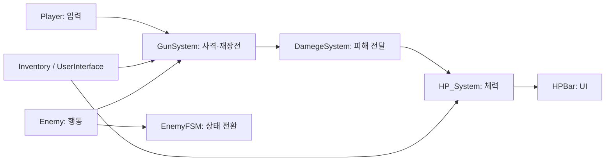

# Unity FPS 프로젝트 | 개발 포트폴리오

> **Unity · C# · FSM / State Pattern · NavMeshAgent · Raycast · ScriptableObject**  
> FPS 게임의 적 AI, 사격·피격, 인벤토리 및 회복 시스템을 구현·연동하고 오류를 분석해 개선한 개인 프로젝트입니다.

**[게임 소스코드 (GitHub)](https://github.com/youngchan-kim/fps_project)** · **[프로젝트 개요](Project/overview.md)** · **[아키텍처](Project/architecture.md)** · **[코드 리뷰](Project/code-review.md)**

## 프로젝트 소개

Unity 기반 FPS 게임에서 플레이어 입력과 총기 발사, 적 AI의 탐지·추적·공격, 아이템 관리와 HP 회복을 연결했습니다. 단순한 기능 나열보다 **상태 관리 구조 개선, 컴포넌트 간 데이터 전달, 재현 가능한 버그 수정**에 초점을 맞췄습니다.

## 핵심 기능

| 영역 | 구현 내용 | 검증 상태 |
|---|---|---|
| **Enemy FSM** | Idle / Reconnaissance / Run / Attack / Die, 타겟 탐지·추적·정찰, NavMeshAgent | 주요 동작 Unity 확인 |
| **사격·데미지** | 단발·연사, Raycast 명중, 피해 전달, 탄창과 인벤토리 탄약 연동 재장전 | 탄약 소모·재장전 Unity 확인 |
| **인벤토리** | Ground·일반·총기 슬롯 이동, 총기 장착 연동, 의료품 사용 | 의료품 사용 검증; 일부 슬롯 기능 추가 검증 필요 |
| **HP·회복** | HP UI, 코루틴 기반 점진적 회복, 회복 중 피격 처리 | 의료품 소모·HP 변화 Unity 확인 |

> 'Unity 확인'은 개발자가 플레이 모드에서 확인했다고 보고한 결과입니다. 전체 기능에 대한 자동화 테스트 완료를 의미하지 않습니다.

## 핵심 시스템 구조

위 다이어그램은 주요 시스템의 **논리적 연결 요약**입니다. 클래스별 책임과 실제 호출 흐름은 [Architecture](Project/architecture.md)에 상세히 정리했습니다.

## 주요 문제 해결 사례

### 1. 적 AI 상태 관리 리팩터링
기존 `Enemy.cs`의 `switch` 기반 상태 관리에서 `IEnemyState` 인터페이스와 상태 클래스로 전환 조건을 분리했습니다. `EnemyFSM`이 상태 진입·종료를 관리하고 `Enemy`는 이동·공격 동작을 수행합니다. [상세 기록](Project/Enemy_FSM_Development.md)

### 2. 재장전 동작과 애니메이션 조건 불일치
인벤토리에 탄약이 없어도 재장전 애니메이션이 재생되는 문제를 발견했습니다. 실제 재장전 가능 여부와 애니메이션 실행 조건을 일치시키도록 수정하고 플레이 모드에서 해결을 확인했습니다. [상세 기록](Project/Shooting_Damage_System_Development.md)

### 3. 의료품 회복 중 피격 데미지 상쇄
고정 목표 HP를 기준으로 회복하던 방식에서는 회복 중 받은 피해가 최종 HP에 반영되지 않았습니다. `remainingHeal`로 **남은 회복량**을 관리하도록 변경해, **HP 30 + 회복 70 + 회복 중 피해 10 → 최종 HP 90** 동작을 확인했습니다. [상세 기록](Project/Inventory_System_Development.md)

## 기술 스택

- **엔진·언어:** Unity, C#
- **AI·이동:** FSM, State Pattern, NavMeshAgent
- **전투:** Physics.Raycast, Coroutine, Unity Animation
- **데이터·UI:** ScriptableObject, Unity UI
- **형상 관리:** Git, GitHub

## 기술 문서

| 문서 | 설명 |
|---|---|
| [Overview](Project/overview.md) | 프로젝트 목적, 기능, 기여 범위, 검증 현황 |
| [Architecture](Project/architecture.md) | 시스템 구성도, 클래스 관계도, 상태도, 시퀀스 |
| [Code Review](Project/code-review.md) | 핵심 코드 분석, 설계 선택, 버그 및 개선 방향 |
| [Development Flow](Project/development-flow.md) | 개발·테스트·디버깅 절차 및 실행 흐름도 |
| [Enemy FSM Development](Project/Enemy_FSM_Development.md) | 적 AI FSM 구현 및 리팩터링 기록 |
| [Shooting & Damage Development](Project/Shooting_Damage_System_Development.md) | 사격·피격·재장전 구현 기록 |
| [Inventory Development](Project/Inventory_System_Development.md) | 인벤토리 확장, 의료품·HP 연동 기록 |

## 직접 구현과 참고 범위

인벤토리의 기본 ScriptableObject 데이터·슬롯·드래그 UI 구조는 [공개 튜토리얼](https://github.com/sniffle6/Scriptable-Object-Inventory)을 참고했습니다. FPS 전용 Ground/총기 슬롯 연동, 의료품·HP 처리, 기존 Enemy FSM의 State Pattern 리팩터링, 사격·재장전 조건 개선 등은 프로젝트에서 확장·수정한 부분입니다.

## 현재 상태와 향후 작업

**확인된 항목:** 적 탐지·추적·공격·정찰 복귀, 탄약 소모·재장전, 의료품 사용과 마지막 1개 소모, HP UI 및 회복 중 피격 반영.  
**추가 검증:** 인벤토리 저장·복원, 정렬 및 드래그 경계 사례, 총기 교체 중 재장전, 적 AI 탄약 정책, 일부 초기화 경로.  
**포트폴리오 마무리:** 실제 Unity 실행 화면과 코드 캡처를 `Images/`에 정리하고 제출용 PDF를 `PDF/`에 제작할 예정입니다.

---

*이 저장소는 포트폴리오 문서 모음입니다. 실제 Unity 게임 소스는 상단의 `fps_project` GitHub 링크를 참고해 주세요.*
