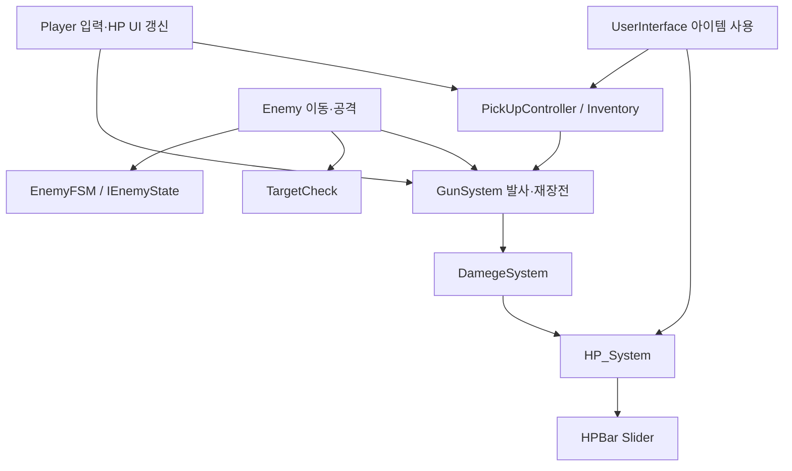
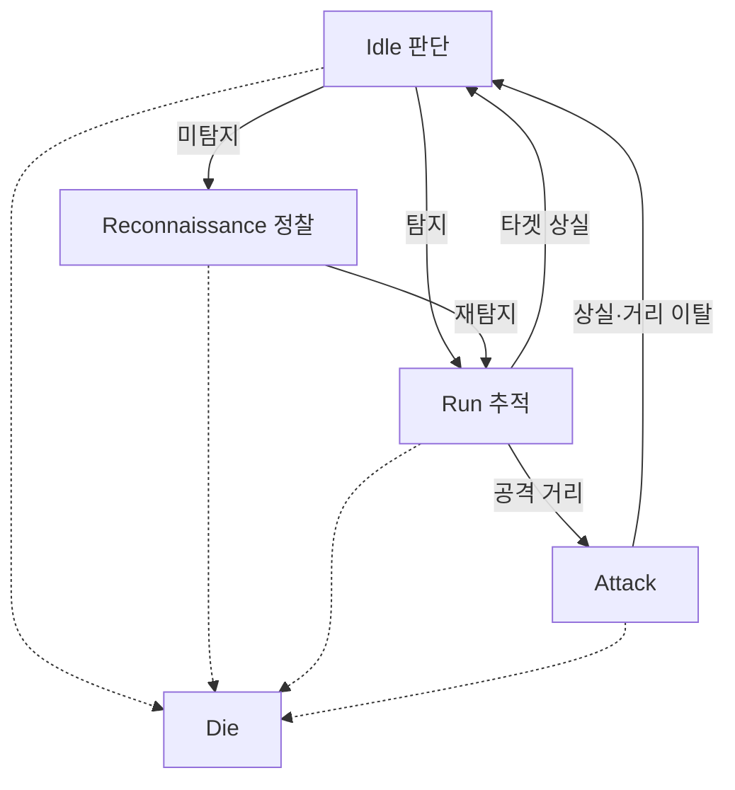
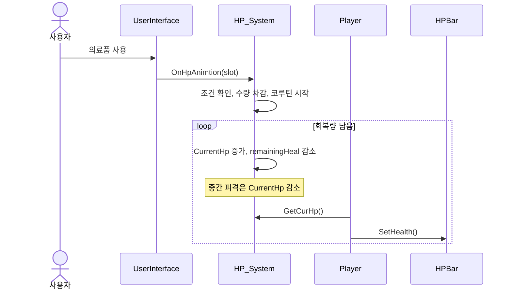

# Architecture — 시스템 구조

> 아래는 핵심 소스와 기존 개발 문서를 기반으로 한 논리적 연결도이며, 전체 프리팹의 모든 참조를 추출한 것은 아니다.

## 시스템 연결

## Enemy 상태 전환

## 의료품 사용 시퀀스

## 클래스 책임
- `Player`: 입력, 활성 총기, HP 초기화 및 UI 반영
- `GunSystem`: 사격, Raycast, 탄약, 재장전
- `DamegeSystem`: 피격 대상 HP 감소 연결
- `HP_System`: 현재 HP 및 코루틴 회복
- `EnemyFSM`, `IEnemyState`: 상태 전환
- `Enemy`, `TargetCheck`: 이동·공격과 타겟 탐지
- `UserInterface`, `InventoryObject`, `InventorySlot`: 슬롯 이동 및 아이템 사용

## 설계상 주의
`transform.GetChild()` 계층 의존, GameMgr 초기화 경로, 인벤토리 직렬화와 적의 탄약 관리 분리는 후속 점검 대상이다.
