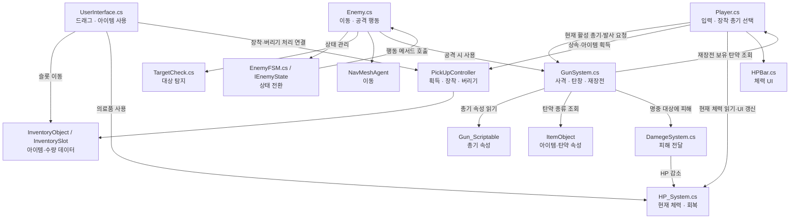
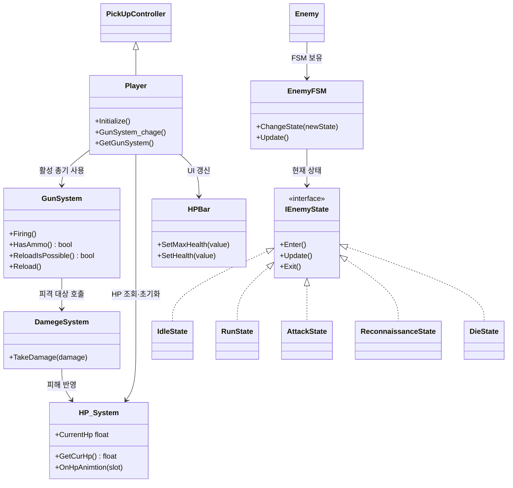
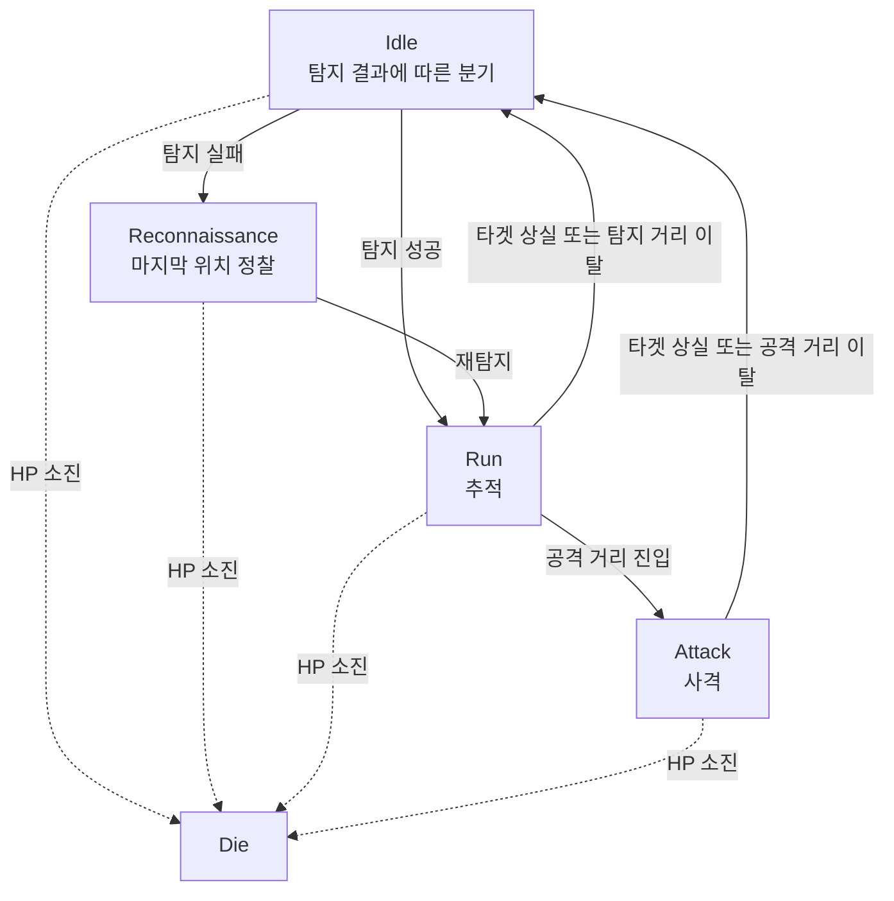
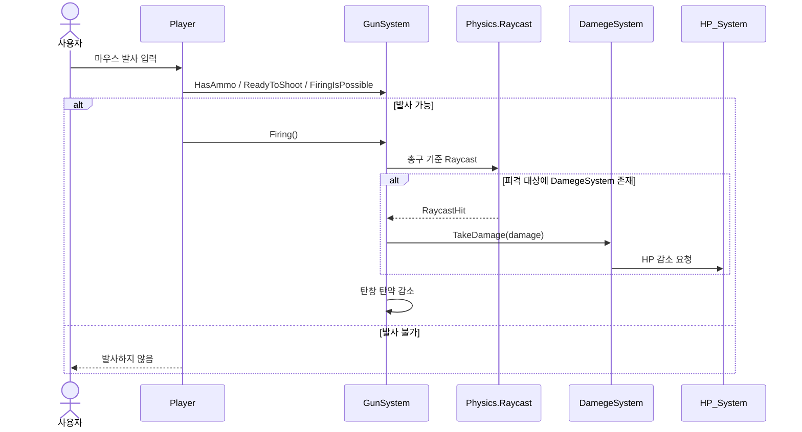
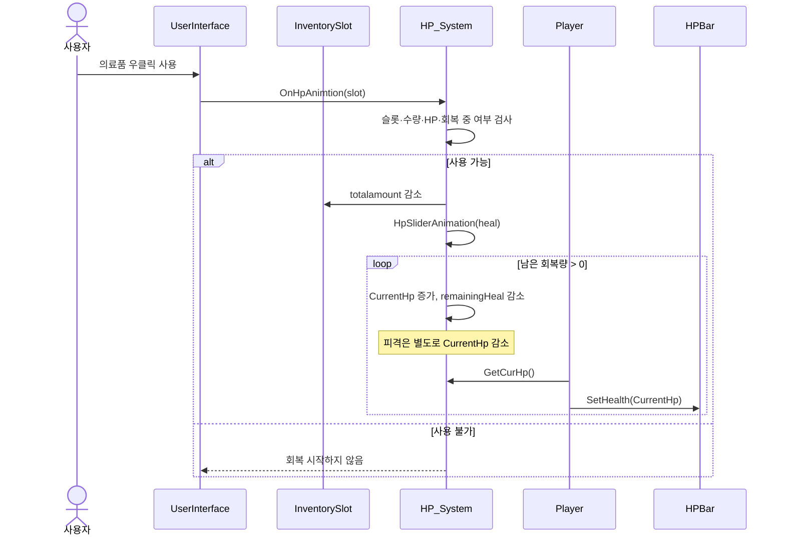
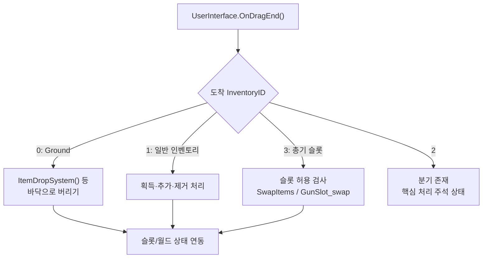

# Unity FPS 시스템 아키텍처 (Architecture)

> 프로젝트: [fps_project](https://github.com/youngchan-kim/fps_project)  
> 기준: `Enemy_FSM_Development.md`, `Shooting_Damage_System_Development.md`, `Inventory_System_Development.md`, `overview.md` 및 GitHub `main`의 `EnemyFSM.cs`, `GunSystem.cs`, `HP_System.cs`, `Player.cs` 확인(2026-10-19).  
> **범위:** 주요 게임플레이 시스템의 **논리적 구조**. Unity Scene/Prefab의 모든 Inspector 참조를 완전히 추출한 도면은 아니다. 화살표는 아래에서 정의한 호출·데이터 사용 관계를 의미한다.

## 1. 아키텍처 개요

프로젝트는 플레이어 입력, 총기·데미지, 적 AI, 인벤토리, HP/UI를 여러 Unity 컴포넌트와 ScriptableObject 데이터로 연결한다. 각 기능이 완전히 독립된 계층으로 구현된 것은 아니며, `Player`, `Enemy`, `GunSystem` 사이에 직접 참조가 존재한다.

> **화살표 주의:** `Player → HPUI`는 `Player.Update()`의 표시 갱신 호출이다. `HP_System`이 `HPBar`를 직접 갱신하는 구조로 표현하지 않는다. `GunSystem → Player`는 재장전 시 플레이어 인벤토리 조회에 따른 현재 구현상의 의존 관계다.

## 2. 주요 클래스와 책임

| 영역 | 클래스·구성 요소 | 책임 |
|---|---|---|
| 플레이어 | `Player` | 입력, 현재 활성 총기 탐색, HP 초기화, HP UI 갱신 |
| 아이템 | `PickUpController` | 아이템 획득·버리기 및 총기 슬롯 연동 |
| 인벤토리 | `UserInterface`, `InventoryObject`, `InventorySlot` | UI 입력 분기, 슬롯 및 수량 관리 |
| 데이터 | `ItemObject`, `Gun_Scriptable` | 아이템/탄약 데이터, 총기별 성능 설정 |
| 전투 | `GunSystem` | 발사 조건, Raycast, 탄창, 재장전 |
| 피격 | `DamegeSystem`, `HP_System` | 피해 전달, 현재 HP, 생존 및 회복 |
| 표시 | `HPBar` | 체력 Slider 값 표시 |
| 적 AI | `EnemyFSM`, `IEnemyState`, 상태 클래스 | 상태 관리·전환 조건 |
| 적 행동 | `Enemy`, `TargetCheck`, `NavMeshAgent` | 탐지, 이동, 정찰, 공격 |

### 핵심 클래스 관계 (선별)

> `classDiagram`은 설명에 필요한 일부 관계만 표현한다. 전체 멤버 목록이나 UML의 엄격한 소유권·생명주기 관계를 뜻하지 않는다.

## 3. 적 AI 상태 전환

`EnemyFSM`은 현재 `IEnemyState`를 보관하고 `ChangeState()`에서 기존 상태 `Exit()` → 새 상태 `Enter()`를 실행한다. 실제 NavMesh 이동·공격은 `Enemy`의 메서드에서 처리한다.

`Attack → Idle`은 현재 타겟을 다시 확인한 뒤 추적 또는 정찰을 결정하기 위한 설계다. `Die` 판정은 `EnemyFSM.Update()`의 공통 경로에서 수행한다.

## 4. 사격·피격 처리 흐름

- `GunSystem`의 총구(`GunMuzzle`) 기준 Raycast와 화면 중앙 조준 목표는 별개이므로 총구·조준점 정렬은 프리팹별로 확인해야 한다.
- 재장전은 탄창 부족분과 인벤토리 보유 탄약을 비교하여 보충하는 구조다.

## 5. 인벤토리·회복 처리 흐름

**검증 예:** HP 30에서 회복량 70인 의료품을 사용해 회복 중 10 피해를 받으면 최종 HP는 90으로 유지된다. 회복량을 고정 목표 HP가 아닌 `remainingHeal`로 관리하기 때문이다. 의료품 마지막 1개 소모와 HP UI 갱신도 개발자가 Unity에서 확인했다.

## 6. 인벤토리 이동과 총기 장착

기본 슬롯·드래그 UI 구조는 공개 ScriptableObject 인벤토리 튜토리얼을 참고했다. FPS 전용 Ground 이동, 총기 슬롯 연동, 의료품 사용은 프로젝트에 맞춰 확장한 영역이다. **총기 장착·버리기의 모든 예외 시나리오가 검증되었다는 의미는 아니다.**

## 7. 현재 구조의 한계 및 개선 후보

| 항목 | 현재 구조 또는 확인된 한계 | 향후 방향 |
|---|---|---|
| 총기 참조 | `Player`가 깊은 `transform.GetChild()` 계층을 통해 총기 부모를 찾음 | Inspector 참조 등 명시적 연결 |
| 적 총기 재장전 | `GunSystem`이 `GameMgr.Instance.player`를 통해 플레이어를 참조 | 적·플레이어 탄약 정책 분리 |
| UI 갱신 | `Player.Update()`에서 HPBar 값을 매 프레임 갱신 | HP 변경 이벤트 방식 검토 |
| 저장·불러오기 | 인벤토리 `BinaryFormatter` 및 GameObject 참조 직렬화 문제 | 직렬화 가능한 데이터만 분리 |
| 슬롯 처리 | 수량 누적·정렬·드래그 예외 사례 추가 검증 필요 | 경계값 테스트 및 방어 코드 |
| 초기화 | `Enemy` 중복 초기화 호출은 수정 확인, `GameMgr` 경로는 추가 점검 | 초기화 책임·호출 시점 정리 |

위 표의 개선 후보는 **현재 구현 완료 기능이 아니다.**

## 8. 관련 문서

- [Overview](overview.md)
- [Enemy FSM 개발 기록](Enemy_FSM_Development.md)
- [Shooting & Damage 개발 기록](Shooting_Damage_System_Development.md)
- [Inventory 개발 기록](Inventory_System_Development.md)
- [Code Review](code-review.md) *(작성 예정)*
- [Development Flow](development-flow.md) *(작성 예정)*

---

**검증 상태:** 핵심 소스 구조 확인 + 개발자가 보고한 Unity 실행 결과. 전체 Scene/Prefab 자동 분석이나 모든 경계 조건의 테스트 완료를 의미하지 않는다.
