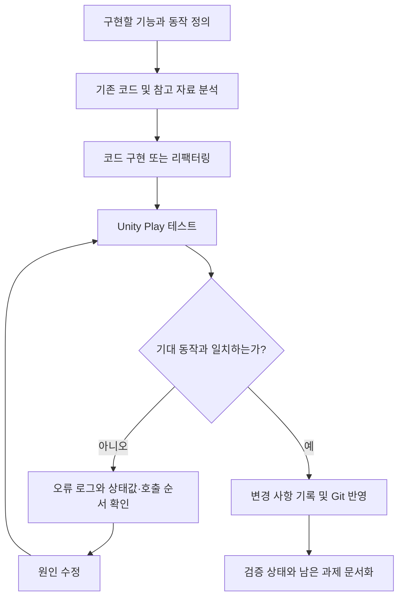
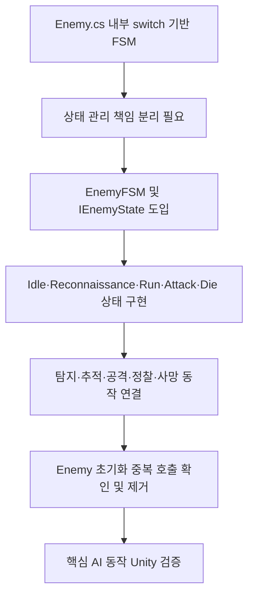
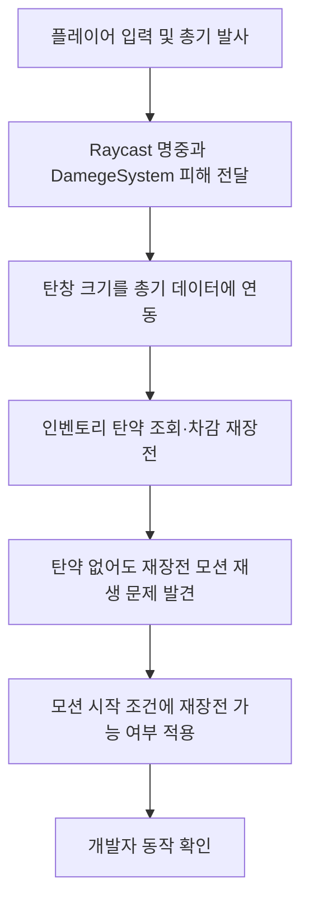
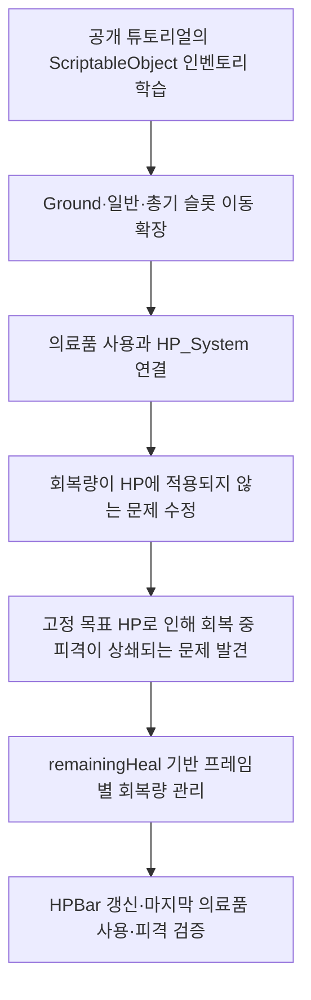
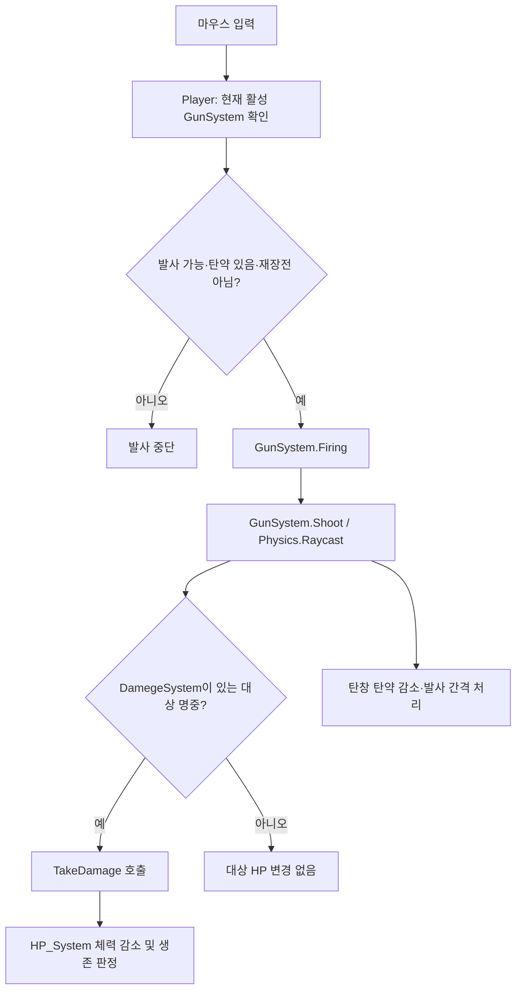
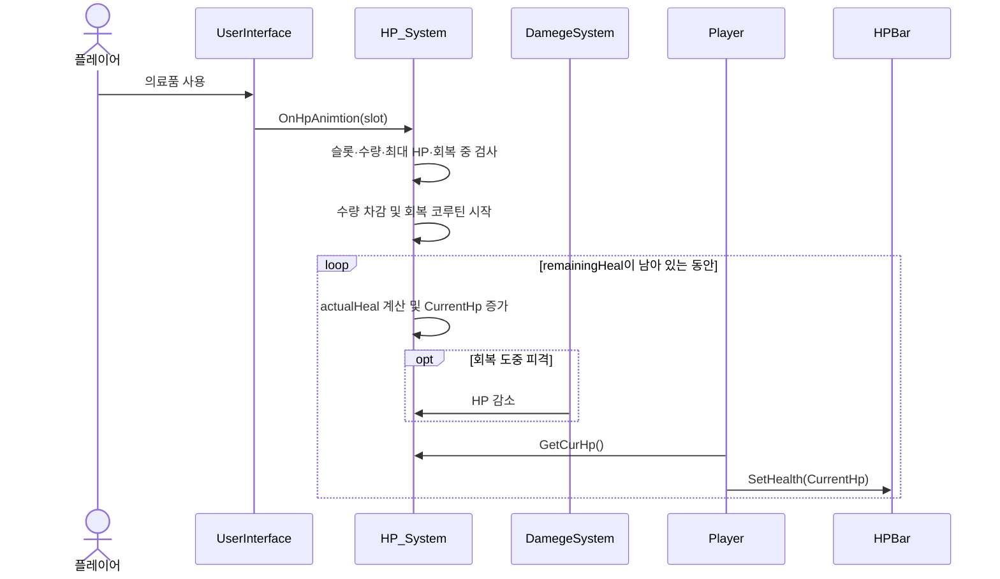
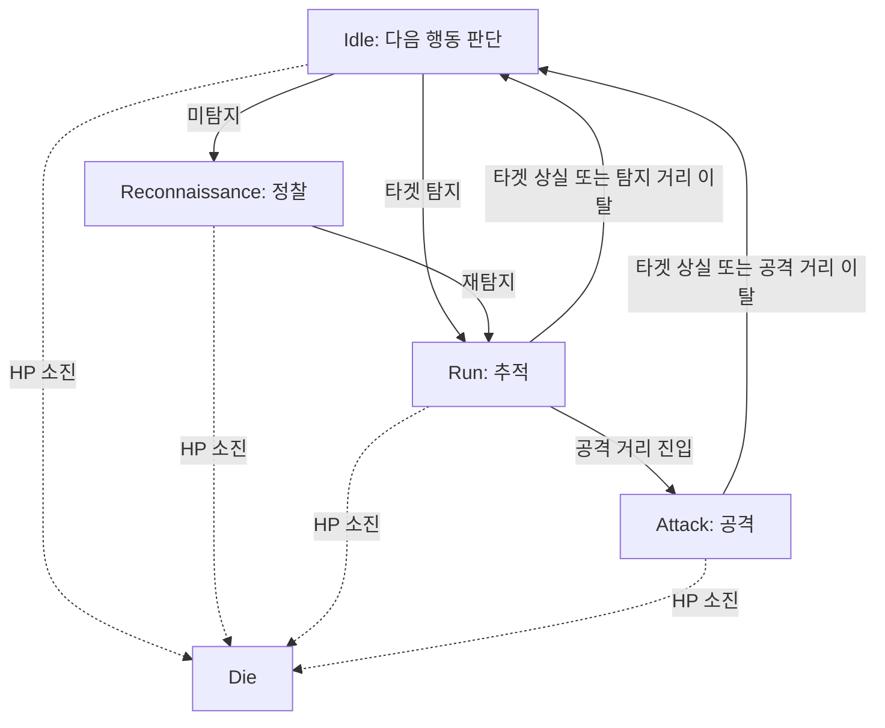

# Unity FPS 개발 흐름 (Development Flow)

> 프로젝트: [fps_project](https://github.com/youngchan-kim/fps_project)  
> 문서 기준: `Enemy_FSM_Development.md`, `Shooting_Damage_System_Development.md`, `Inventory_System_Development.md`, 기존 `flowchart TD.md`, `architecture.md`, `code-review.md`.  
> 구분: **개발 절차**는 작업 방법을 정리한 개념도이며, **기능 실행 흐름**은 런타임 호출 관계다. 모든 작업의 실제 시간순 연혁은 아니다.

## 1. 문서 목적

이 문서는 세 가지 시스템을 구현·개선한 과정을 한눈에 보여준다. 클래스 간 의존 관계는 [`architecture.md`](architecture.md), 코드의 장단점과 버그 원인은 [`code-review.md`](code-review.md), 세부 구현 근거는 각 `*_Development.md`에서 다룬다.

## 2. 개발 및 검증 작업 흐름

위 그림은 일반화된 **작업 절차**다. 실제 구현 순서나 커밋 날짜를 증명하는 도표로 사용하지 않는다.

## 3. 시스템별 개발·개선 흐름

### 3.1 Enemy FSM

- **코드 근거:** `EnemyFSM.ChangeState()`의 `Exit()` → 상태 교체 → `Enter()`와 상태별 `Update()`.
- **설계 결정:** `Attack → Idle`로 돌아간 뒤 탐지 여부를 다시 판단한다.
- **검증 범위:** 작성자가 탐지·추적·공격·정찰 복귀·HP 감소 및 사망의 핵심 동작을 Unity에서 확인. 사망 애니메이션 종료, 오브젝트 풀링 등은 별도 검증·구현 과제.

### 3.2 사격·데미지·재장전

- **코드 근거:** `Player`의 입력 조건 검사, `GunSystem.Firing()` / `Shoot()`, `ReloadIsPossible()`, `DamegeSystem.TakeDamage()`.
- **문제 해결:** 실제 재장전은 제한됐으나 애니메이션은 R키 입력만으로 시작되던 조건 불일치 수정.
- **검증 범위:** 탄약 소진 시 발사 제한, 인벤토리 탄약을 사용한 재장전, 모션 조건 수정은 개발자 확인. 최종 수정 코드의 GitHub 반영 여부와 무기 교체 중 재장전은 추가 확인.

### 3.3 인벤토리·의료품 회복

- **기여 범위:** 슬롯·드래그의 기초 구조는 공개 튜토리얼 참고. FPS용 인벤토리 분기와 의료품 연동을 확장.
- **검증 사례:** HP 30 + 회복량 70 → HP 100. 회복 도중 데미지 10 → 최종 HP 90. 의료품 수량 감소 및 마지막 1개 사용 확인.
- **미검증:** 전체 아이템 이동 시나리오, 정렬 경계 사례, 저장·불러오기.

## 4. 게임 실행 흐름 — 발사부터 피격까지

> 이 도표는 발사 요청 이후의 **실행 흐름**이며, 실제 구현의 모든 예외 처리·시각 효과 호출을 포함한 전체 코드 추적은 아니다.

## 5. 게임 실행 흐름 — 의료품 사용과 회복 중 피격

회복은 고정된 목표 HP로 이동하는 방식이 아니라 **남은 회복량을 소모**하는 방식이다. 피격으로 줄어든 체력이 자동으로 추가 복원되지 않도록 설계했다.

## 6. Enemy FSM 실행 상태 흐름

`Die` 상태는 `EnemyFSM.Update()`의 공통 사망 검사에서 진입한다.

## 7. 기존 `flowchart TD.md` 정리 방침

기존 파일은 이름과 달리 **적 AI FSM 개발·리팩터링 분석 문서**다. 단순한 전체 개발 흐름도는 아니다.

- **권장:** 기존 `flowchart TD.md`를 바로 삭제하지 말고 `Enemy_FSM_Development.md`와 차이를 검토한다.
- 과거 커밋 비교 등 고유한 근거가 있으면 기존 Enemy FSM 개발 문서로 옮기거나 별도 기록으로 보존한다.
- 전체 개발·검증 절차 및 세 시스템 실행 흐름은 **이 파일 `development-flow.md`**를 기준 문서로 사용한다.

## 8. 남은 확인 항목

- [ ] 실제 Git 커밋 날짜를 기준으로 변경 이력 작성
- [ ] 재장전 애니메이션 조건 수정의 최신 코드 반영 여부 확인
- [ ] 인벤토리 드래그·총기 교체·정렬·저장/복원 테스트
- [ ] GameMgr·Player·Enemy 초기화 순서 및 null 참조 재검증
- [ ] Mermaid 다이어그램 GitHub 미리보기 확인
- [ ] 대표 실행 화면을 `Images/`에 추가

---

**연관 문서:** [Overview](overview.md) · [Architecture](architecture.md) · [Code Review](code-review.md) · `Enemy_FSM_Development.md` · `Shooting_Damage_System_Development.md` · `Inventory_System_Development.md`
